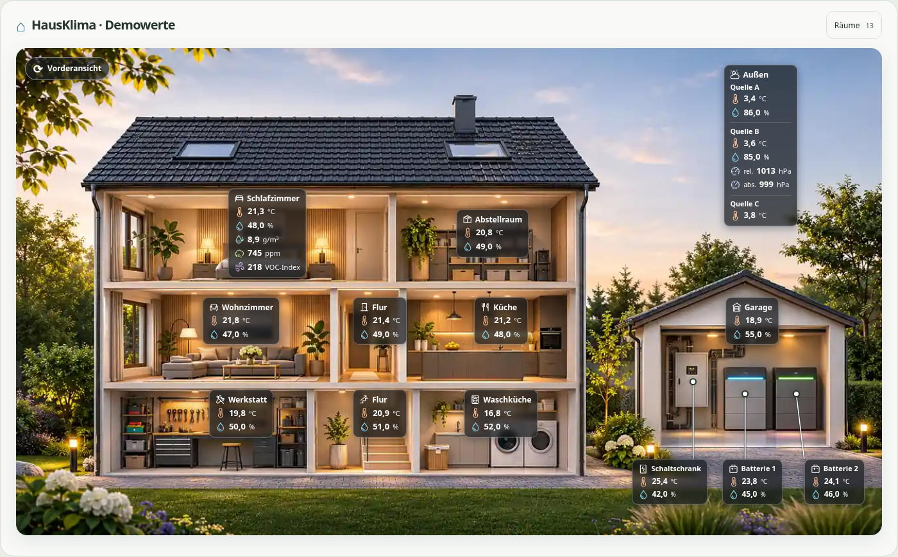

# HausKlima Card

HausKlima Card zeigt die Messwerte deiner Home-Assistant-Sensoren auf einer Hausgrafik mit Vorder- und Rückansicht. Räume, Garage und Außenmessorte können eigene Sensoren und frei platzierbare Messwertkästchen haben. Die Karte passt sich an Desktop und Handy an.

*Beispiel mit Demowerten.*

## Installation mit HACS

1. Öffne in HACS **Benutzerdefinierte Repositories** und füge `https://github.com/tach2004/hausklima-card` als Typ **Dashboard** hinzu.
2. Lade **HausKlima Card** herunter.
3. Prüfe unter **Einstellungen → Dashboards → Ressourcen**, ob `/hacsfiles/hausklima-card/hausklima-card.js` als **JavaScript-Modul** eingetragen ist. Füge die Ressource bei Bedarf hinzu und lade die Seite neu.

## Manuelle Installation

1. Lade `hausklima-card.js` aus dem [aktuellen Release](https://github.com/tach2004/hausklima-card/releases/latest).
2. Lege die Datei im Ordner `www` deiner Home-Assistant-Konfiguration ab. Starte Home Assistant neu, falls du den Ordner gerade erst angelegt hast.
3. Füge `/local/hausklima-card.js` unter **Einstellungen → Dashboards → Ressourcen** als **JavaScript-Modul** hinzu und lade die Seite neu.

## Karte einrichten

1. Füge **HausKlima Card** zu deinem Dashboard hinzu. Eine eigene **Panel-Ansicht** mit dieser einen Karte bietet der Grafik am meisten Platz.
2. Wähle im Karteneditor einen Raum oder Messort. Über **Raum oder Außenmessort hinzufügen** legst du weitere Messorte an.
3. Wähle eine Messart und ordne ihr eine Home-Assistant-Entität zu. Über **Haupt – in Übersicht** und **Handy – diesen Sensor anzeigen** bestimmst du, welche Quellen in den Kästchen erscheinen. Der gleiche Gruppenname fasst zusammengehörige Quellen in einem Kästchen zusammen.
4. Öffne **Messwertkästchen im Bild verschieben** und ziehe die Kästchen an ihre Plätze. Positionen für Desktop und Handy lassen sich getrennt speichern.
5. Speichere das Dashboard. Ein Tipp oder Klick auf ein Kästchen öffnet die zugehörigen Messwerte und Quellen.

Für die Einrichtung per YAML gibt es ein [Kartenbeispiel](examples/basic.yaml) und [Beispiele für Dashboard-Ansichten](examples/views/README.md).
