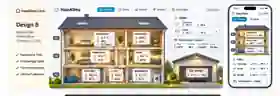
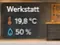
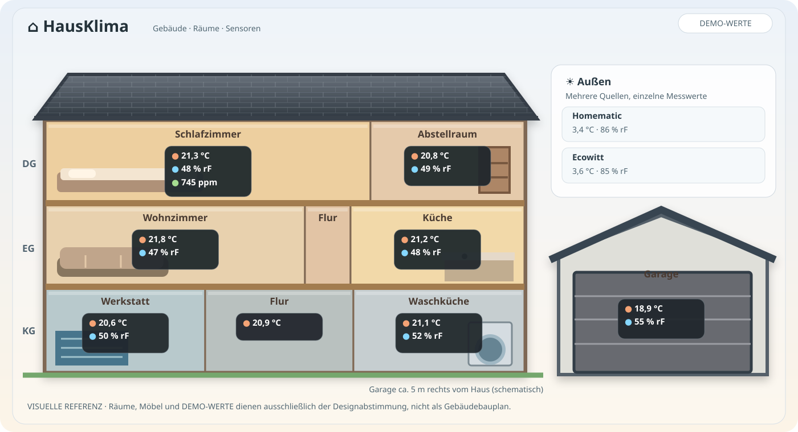
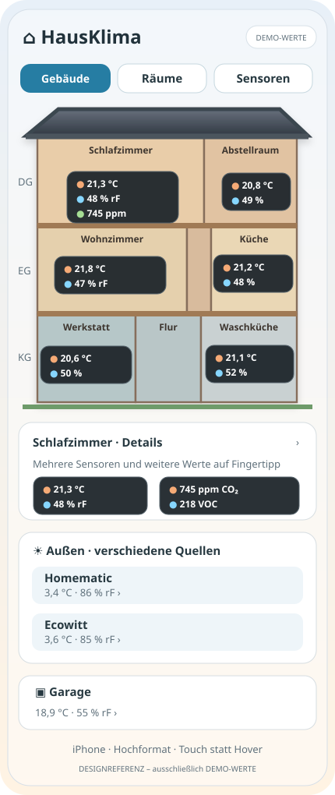

# HausKlima — verbindliche visuelle Referenz für Phase 2

**Freigegebene Richtung:** Design B, der **wohnliche, räumliche (2,5D) Architektur-Cutaway**. **Änderung gegenüber dem früheren hellen Mockup:** Alle Messwertanzeigen im Gebäude sollen als **dunkle, kontrastreiche Panels** gestaltet werden. Desktop- und iPhone-Gestaltung sind gleichberechtigte Ziele.

## Bildreferenzen aus der freigegebenen Gestaltung

Diese zusätzlichen **echten Bilddateien** (komprimierte Vorschaubilder aus den im Chat ausgewählten Referenzen) verdeutlichen die gewünschte hochwertige, warme 2,5D-Anmutung und die konkrete Form der dunklen Messwertanzeige. Keine dieser Dateien wird als starrer Hintergrund in die produktive Karte übernommen.

- [Ausgewähltes Design B – Bildreferenz](design-b-selected-photo.webp) – vom Projektinhaber ausgewählter räumlicher Haus-Cutaway, einschließlich Desktop und iPhone; das Bild dient der **Atmosphäre und Gesamtkomposition**, die ursprünglich gezeigten hellen Kästchen sind **nicht** die gewünschte Endversion
- [Dunkle Messwert-Kästchen – Ausschnitt](design-b-dark-chip.webp) – vom Projektinhaber gewünschtes dunkles, gut lesbares Messfeld; **dessen Hintergrund soll leicht transparent sein**

### Ganz wichtig: Transparenz der dunklen Messwert-Kästchen

- Dunkel anthrazit/schwarz, aber **leicht durchsichtig**: der jeweilige Raum bzw. die Einrichtung bleibt dezent dahinter sichtbar.
- Gestalterischer **Startwert** z. B. `background: rgba(22, 26, 30, 0.82)`; Feinabstimmung nach Screenshots bei etwa 0,75–0,88. Das ist ein vorgeschlagener Designparameter, **kein bestätigter exakter Alphawert**.
- Optional dezenter `backdrop-filter: blur(3px)` mit robuster Safari-/Fallback-Darstellung.
- **Nur Hintergrund transparent gestalten!** Nicht `opacity: 0.82` auf den gesamten Kasten anwenden, sonst werden Text, Temperaturzahlen und Icons mit ausgegraut.
- Weiße/helle Beschriftungen, kräftige Werte und klar sichtbare Symbole bleiben voll deckend. Kontrast auch auf iPhone/kleinen Karten und in HA Light/Dark Theme prüfen.
- Beliebig viele Messwerte und kleine Räume können nicht alle mit gleich großen Kästchen abgedeckt werden: bei Platzmangel eine kompaktere Darstellung mit aufklappbaren Raumdetails verwenden.

## Visuelle Designvorlagen im Repository

| Format | Datei | Einsatz |
|---|---|---|
| **Desktop / Panel** | [design-b-desktop.svg](design-b-desktop.svg) | Haus-Cutaway mit warmen Räumen, dunklen Messwertfeldern, Außenquellen und freistehender Garage |
| **iPhone / Hochformat** | [design-b-mobile.svg](design-b-mobile.svg) | Vereinfachter Grundriss im vertikalen Layout, Raumdetails und Außenquellen darunter |

**Diese SVG-Dateien sind echte, mit GitHub/Codex direkt abrufbare Visual-Assets**, bewusst als vereinfachte, editierbare Vektorreferenzen erstellt. Sie illustrieren die vom Projektinhaber ausgewählte Bildrichtung; sie sind **keine pixelgenauen Kopien** der zuvor im Chat gezeigten fotorealistischen Design-B-Abbildung. Alle im Bild lesbaren Werte sind **ausdrücklich erfundene Demo-Werte**, nicht echte HA-Daten. Die dargestellten Möbel, Fenster, Dachdetails und Innenausstattung sind rein dekorativ und **keine bestätigten Eigenschaften des Hauses**.

### Gestalterische Leitplanken

- Der bisherige Bildschirm aus PR #1 (weitläufiger Header, technische Liniengrafik, Schraffurhinweis, abgeschnittene Garage, kaum Werte) ist **kein** Stilvorbild.
- Raumkulisse: hochwertiger, warmer, ruhiger Architektur-Look. Kein fotorealistisches Versprechen notwendig, lieber stilisiertes SVG mit subtilen Licht-/Tiefen-/Materialeffekten. Ein sehr dichtes Möbel-Inventar, bewegte Szenen oder photorealistische Bild-Assets sind **nicht** notwendig.
- **Messwert-Panels:** dunkles Anthrazit etwa `#20272D` (oder themenadaptives Pendant), leicht transparent über Raumhintergrund; **helle, kräftige Texte**; sparsame farbige Symbole für Temperatur, Feuchte, CO₂. Kein schwarzer Text auf unruhigem Foto-Hintergrund. Auf ausreichendes Kontrastverhältnis und gut lesbare Einheiten achten.
- Keine großen Titel, keinen navigationsartigen Ballast über dem Haus und keine erklärenden Maßketten als Hauptelement. Technische Maße optional im Editor/Detail.
- Die Hauptwerte in einem Raum sind **Temperatur + relative Feuchte**. Absolute Feuchte, CO₂ und VOC erscheinen optional, wenn konfiguriert und individuell eingeblendet. Bei mehreren Sensoren Hauptsensor zeigen, übrige in Details.
- Außen soll Homematic und Ecowitt **separat** anzeigen können, ohne doppelte Räume im Gebäudeschnitt erzwingen zu müssen.
- **Garage vollständig sichtbar**, nicht angeschnitten. Auf schmalen Geräten kann Garage unten als eigene Karte stehen. Auch Außenmesswerte und verdeckte Räume stets erreichbar.
- Art der Raumdarstellung kann zwischen Desktop und iPhone wechseln, ohne unterschiedliche YAML-Konfigurationen.

### Wichtige geometrische Abweichung der Illustration

Die Vorlagen sind **ästhetische Zielbilder, keine Baupläne**. Maßgeblich für die reale Hausgeometrie sind `AGENTS.md` und `docs/architecture.md`:

- Wir blicken auf die **12-m-Traufseite**, der First läuft **parallel** zur Fassade. An der Hausfront **keinen Dreiecksgiebel** erzeugen.
- Haus 12 × 10 m, Keller 2,50 m, EG 2,64 m, DG Kniestock 1,00 m und First innen 4,00 m.
- Raumfolge und -maße gemäß den Projektdaten; unbekannte Wandzuordnung, Dachneigung, Deckenstärke und Restmaße **nicht erfinden**.
- Garage 6 × 6 m, 3 m hoch, ca. 5 m rechts freistehend. Die Garage darf im Mockup eine grafische Dachsilhouette haben, deren Bauform **nicht** als echte Eigenschaft übernehmen.
- Die Mockups zeigen nur exemplarische Raumkonturen und Inhalte. Die endgültige Position eines Wertes muss aus den **konfigurierten** Räumen/Sensoren folgen, nicht aus im Bild fixierten Zahlen.

### Responsive Verhalten / iPhone 17

Auf dem iPhone hochkant nicht alle Desktop-Beschriftungen auf ein Miniaturbild quetschen:
- verkleinerter, aber erkennbarer Gebäudeschnitt als Navigationshilfe,
- große klare Klimawerte im aktiven Raum / ausgewählten Raumdetail,
- alle Räume per Touch erreichbar, bei Bedarf untereinander gelistete Räume,
- Außen/ Garage/ verdeckte Räume als nachfolgende Bereiche,
- keine verschobene oder versteckte Garage hinter Scrollleisten, keine horizontalen Seitenüberläufe,
- Touch-Ziele, Kontrast, Light/Dark Theme, Hoch-/Querformat prüfen.

### Abnahme

Ein PR muss reale Screenshots der **implementierten** Karte (nicht die Design-Illustrationen) für Desktop und schmalen Viewport in hell/dunkel enthalten bzw. eindeutig zugänglich machen. Der optische Eindruck wird **vor dem Merge** vom Projektinhaber bewertet. Selbst bei bestandenen Unit-Tests gilt: Wenn die UI wieder wie ein Bauplan oder eine abgeschnittene Grafik wirkt, ist die visuelle Aufgabe **nicht** erfüllt.

## Spätere Rückseite (Phase 3)
Aktuell verbindlich: **Variante A** (separate Raumübersicht für nicht sichtbare Räume). Später optional, gezielt geplant: **Variante B**, Umschalter zwischen **Vorne / Hinten**, mit getrennt konfigurierbaren Räumebenen. Das Datenmodell muss spätere Ergänzung ermöglichen. Nicht versuchen, im aktuellen PR eine nicht bestätigte Rückseitengeometrie zu erfinden.
